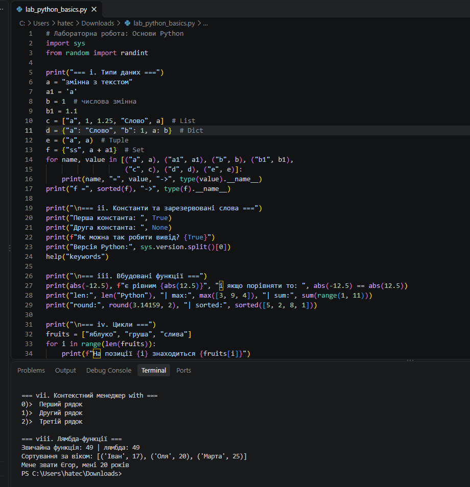

# Звіт до роботи

## Тема: Основи Python

## Мета роботи: навчитися застосовувати основні конструкції мови Python, виконати всі приклади та за допомогою AI створити власні приклади, які демонструють особливості конструкцій мови Python

---

## Виконання роботи

### Результати виконання завдань 1…4

Увесь код знаходиться у файлі [lab_python_basics.py](lab_python_basics.py).

**i. Типи даних**

- Розробили змінні типів `str`, `int`, `float`, `list`, `dict`, `tuple`, `set` та вивели тип кожної через `type(...)`.

```python
a = "змінна з текстом"
a1 = 'a'
b = 1
b1 = 1.1
c = ["a", 1, 1.25, "Слово", a]       # list
d = {"a": "Слово", "b": 1, a: b}     # dict
e = ("a", a)                         # tuple
f = {"ss", a + a1}                   # set
```

Результат:

```
a = змінна з текстом -> str
a1 = a -> str
b = 1 -> int
b1 = 1.1 -> float
c = ['a', 1, 1.25, 'Слово', 'змінна з текстом'] -> list
d = {'a': 'Слово', 'b': 1, 'змінна з текстом': 1} -> dict
e = ('a', 'змінна з текстом') -> tuple
f = ['ss', 'змінна з текстомa'] -> set
```

**ii. Вбудовані константи та зарезервовані слова**

```python
print("Перша константа: ", True)
print("Друга константа: ", None)
print(f"Як можна так робити вивід? {True}")
import sys
print("Версія Python:", sys.version.split()[0])
help("keywords")
```

Результат: виведено `True`, `None`, версію Python та список усіх ключових слів (`False`, `None`, `True`, `and`, `as`, `class`, `def`, `for`, `if`, `try`, `while`, `with`, `lambda` тощо).

**iii. Вбудовані функції**

```python
print(abs(-12.5), f"є рівним {abs(12.5)}", "і якщо порівняти то: ", abs(-12.5) == abs(12.5))
print("len:", len("Python"), "| max:", max([3, 9, 4]), "| sum:", sum(range(1, 11)))
print("round:", round(3.14159, 2), "| sorted:", sorted([5, 2, 8, 1]))
```

Результат:

```
12.5 є рівним 12.5 і якщо порівняти то:  True
len: 6 | max: 9 | sum: 55
round: 3.14 | sorted: [1, 2, 5, 8]
```

**iv. Цикли**

```python
fruits = ["яблуко", "груша", "слива"]
for i in range(len(fruits)):
    print(f"На позиції {i} знаходиться {fruits[i]}")
else:
    print("Цикл for завершився без break")
n = 3
while n > 0:
    print("while: залишилось", n)
    n -= 1
```

Результат:

```
На позиції 0 знаходиться яблуко
На позиції 1 знаходиться груша
На позиції 2 знаходиться слива
Цикл for завершився без break
while: залишилось 3
while: залишилось 2
while: залишилось 1
```

**v. Розгалуження**

```python
from random import randint
A = randint(0, 1)
print(f"Значить A={A}" if A else "Але може бути що A={}".format(A))
score = 78
if score >= 90:
    print("Оцінка: відмінно")
elif score >= 70:
    print("Оцінка: добре")
else:
    print("Оцінка: потрібно підтягнути")
```

Результат (значення `A` випадкове, при кожному запуску може бути 0 або 1):

```
Але може бути що A=0
Оцінка: добре
```

**vi. Конструкція try -> except -> finally**

```python
x = 0
try:
    print("Що буде якщо", 10 / x, "?")
except ZeroDivisionError as err:
    print("Помилка ділення на нуль > ", err)
finally:
    print("Блок finally виконується завжди!")
try:
    int("abc")
except ValueError as err:
    print("Помилка перетворення > ", err)
```

Результат:

```
Помилка ділення на нуль >  division by zero
Блок finally виконується завжди!
Помилка перетворення >  invalid literal for int() with base 10: 'abc'
```

**vii. Контекстний менеджер with**

```python
with open("notes.txt", "w", encoding="utf-8") as fw:
    fw.write("Перший рядок\nДругий рядок\nТретій рядок\n")
with open("notes.txt", "r", encoding="utf-8") as fr:
    for num, line in enumerate(fr):
        print(f"{num})> ", line.strip())
```

Результат:

```
0)>  Перший рядок
1)>  Другий рядок
2)>  Третій рядок
```

**viii. Лямбда-функції**

```python
def square(x):
    return x * x
square_l = lambda x: x * x
print("Звичайна функція:", square(7), "| лямбда:", square_l(7))
people = [("Оля", 20), ("Іван", 17), ("Марта", 25)]
print("Сортування за віком:", sorted(people, key=lambda p: p[1]))
greet = lambda first, age: f"Мене звати {first}, мені {age:d} років"
print(greet("Єгор", 20))
```

Результат:

```
Звичайна функція: 49 | лямбда: 49
Сортування за віком: [('Іван', 17), ('Оля', 20), ('Марта', 25)]
Мене звати Єгор, мені 20 років
```

Як я розумію лямбда-функції: це коротка анонімна функція в один рядок, яка одразу повертає результат виразу. Вона зручна там, де функція потрібна один раз, наприклад як `key` у `sorted()`.

**Завдання 4. Опис основ Python від AI (запит: «Опиши основи Python, я вивчаю Python із використанням Jupyter Notebook»)**

Відповідь AI (відформатована):

- **Jupyter Notebook** складається з комірок: у кодових (`Code`) пишемо й запускаємо код (`Shift+Enter`), у текстових (`Markdown`) пишемо пояснення. Результат останнього виразу в комірці показується одразу під нею.
- **Змінні й типи даних:** `int`, `float`, `str`, `bool`, `list`, `tuple`, `set`, `dict`. Тип не оголошується, а визначається автоматично; перевірити його можна через `type()`.
- **Оператори:** арифметичні (`+ - * / // % **`), порівняння (`== != < >`), логічні (`and or not`).
- **Керування потоком:** `if / elif / else`, цикли `for` і `while`, `break` та `continue`.
- **Функції:** оголошуються через `def`, повертають значення через `return`; `lambda` для коротких одноразових функцій.
- **Обробка помилок:** `try / except / finally` дозволяє перехопити помилку, а не зупиняти програму.
- **Робота з файлами:** `with open(...)` сам закриває файл після використання.
- **Модулі:** `import` підключає стандартну бібліотеку (`random`, `math`, `sys`) та сторонні пакети.

Спроба виконати приклади: усі приклади з відповіді AI виконано, результати наведені вище в пунктах i–viii.

### Вставлені рисунки

Скріншот запуску коду у VS Code (код і результат виконання у терміналі):



### Вставлений код

Повний код: [lab_python_basics.py](lab_python_basics.py)

---

## Висновок:

- **Що зроблено в роботі:** виконано всі приклади з завдання, написано власні приклади для типів даних, констант, вбудованих функцій, циклів, розгалужень, `try/except/finally`, `with` та лямбда-функцій; отримано опис основ Python від AI.
- **Чи досягнуто мети роботи:** так, мету досягнуто, вдалося застосувати основні конструкції Python і створити власні приклади.
- **Які нові знання отримано:** типи даних і їх відмінності (list, tuple, set, dict), конструкція `for ... else`, обробка помилок через `try/except/finally`, контекстний менеджер `with`, лямбда-функції та їх використання як `key` у `sorted()`.
- **Чи вдалось відповісти на всі питання задані в ході роботи:** так.
- **Чи вдалося виконати всі завдання:** так, усі завдання виконано.
- **Чи виникли складності у виконанні завдання:** суттєвих складностей не було; найбільше уваги потребувало розуміння лямбда-функцій та форматування рядків через `f""`.
- **Чи подобається такий формат здачі роботи (Feedback):** так, формат зручний, бо код і результат зберігаються разом у репозиторії.
- **Побажання для покращення (Suggestions):** додати більше прикладів для самостійного виконання та перевірки.
